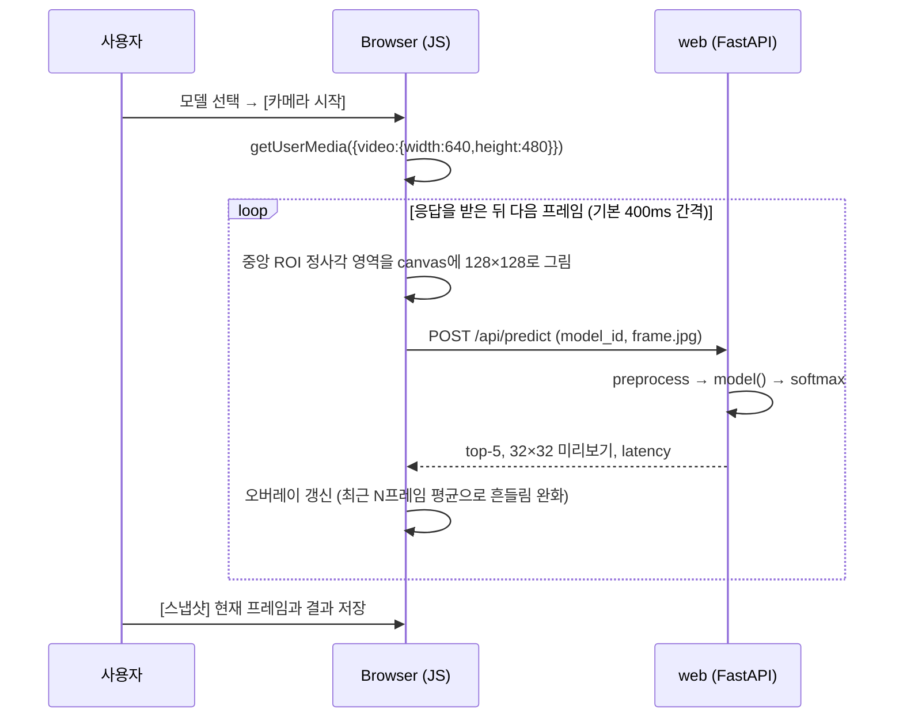

# CIFAR-100 CNN 학습·평가·테스트 Web UI PoC 제안서

| 항목 | 내용 |
|---|---|
| 문서 버전 | v0.6 (다국어 UI) |
| 작성일 | 2026-11-08 |
| 변경 이력 | v0.2: trainer 기본 실행 방식을 **macOS 네이티브(Metal GPU)**로 변경, 네이티브 환경 관리에 **conda**(기본)와 venv(대안) 추가, Docker CPU trainer는 대체 경로로 이동<br>v0.3: 모델을 Keras 예제 기반 **1종**(`xception_mini`)으로 축소, 예제에 없던 `simple_cnn` 제거<br>v0.4: 사진(이미지 파일) 업로드 테스트를 PoC 범위에서 제외. 모델 테스트는 웹캠으로만 진행<br>v0.5: 구현과 Phase 0 실측 반영 (버전 고정, BatchNormalization momentum 0.9, 학습 시간 실측, run.sh 옵션 추가, §12.3)<br>v0.6: 화면 언어 선택 추가 — 한국어·English·中文·Tiếng Việt (§9.4), 학습 설정 항목별 쉬운 설명 추가 (§5.4) |
| 대상 과목 | MGT6710-01 Modern Applied Statistics — AI Analysis Team Project |
| 참고 예제 | [Keras: Image classification from scratch](https://keras.io/examples/vision/image_classification_from_scratch/) (Keras 3, 2023-11-09 수정본) |
| 데이터셋 | [Keras CIFAR-100](https://keras.io/api/datasets/cifar100/) (`keras.datasets.cifar100.load_data`) |
| 실행 환경 | MacBook M2 / RAM 8GB / localhost — web: Docker Desktop(docker-compose), trainer: macOS 네이티브(conda 환경 + Metal GPU) |

---

## 1. 개요

### 1.1 목적
Keras 공식 예제(Image classification from scratch)의 CNN 구조와 학습 절차를 CIFAR-100에 맞게 바꾸고, 아래 기능을 **localhost에서 도는 Python 웹 서버(Web UI)** 하나로 제공한다.

1. 데이터셋 선택
2. 모델 학습
3. 모델 관리
4. 학습된 모델 평가
5. 모델을 골라 MacBook 웹캠으로 실시간 테스트 (사진 파일 업로드 테스트는 PoC 범위에서 제외)

웹 서버(`web`)는 `docker-compose`로 띄운다. 학습 서버(`trainer`)는 Apple GPU(Metal)를 쓰기 위해 **macOS에서 직접(네이티브) 실행**하며, Python 환경은 **conda**로 관리한다. 둘 다 `./run.sh up` 한 줄로 실행된다.

### 1.2 범위 전제: "Detection"이라는 용어
CIFAR-100은 **이미지 한 장에 레이블 하나**만 있고 bounding box 정보가 없다. 그래서 이 데이터로는 위치까지 찾는 객체 탐지(object detection) 모델을 학습시킬 수 없다.
이 PoC에서 말하는 "detection 모델"은 **이미지(또는 웹캠 화면 중앙 영역)에 있는 주 객체가 100개(또는 20개) 클래스 중 무엇인지 알아맞히는 분류(classification) 모델**이다.

- bbox 탐지로 넓히려면 bbox 레이블이 있는 데이터셋(예: Pascal VOC, COCO)과 탐지 아키텍처가 필요하다. 이는 PoC 범위 밖이며 §15 확장 방향에만 적는다.
- 웹캠 화면에서는 "중앙 ROI(관심 영역) 박스"를 보여 줘서, 사용자가 대상을 박스 안에 넣도록 안내한다(분류 모델로 탐지 비슷한 경험을 주는 방식).

### 1.3 PoC 범위

| 포함 (In-scope) | 제외 (Out-of-scope) |
|---|---|
| CIFAR-100 (fine 100클래스 / coarse 20클래스) | 사용자 업로드 데이터셋, 기타 공개 데이터셋 |
| Keras 예제 기반 CNN **1종**(`xception_mini`) 학습·평가. 모델 크기(`width`)와 학습 설정만 바꿔 여러 모델을 만든다 | 예제 밖의 다른 CNN 구조(비교용 기준선 모델 등), 하이퍼파라미터 자동 탐색, 분산 학습 |
| 파일 기반 모델 레지스트리 (목록·상세·이름 변경·삭제·다운로드) | 인증·권한, 다중 사용자, 모델 버전 승인 흐름 |
| 웹캠 실시간 추론 | **사진(이미지 파일) 업로드 테스트**, bbox 객체 탐지, 모바일 앱 |
| 단일 학습 Job 순차 실행 (8GB RAM 제약) | 다중 GPU·클라우드 GPU 학습 |
| Apple GPU(Metal) 학습: trainer를 macOS 네이티브(conda)로 실행 (§3.2) | Windows·Linux·Intel Mac 지원 |

---

## 2. 환경 제약 분석 (M2 / 8GB / Docker)

설계 결정의 대부분이 이 제약에서 나온다.

| 제약 | 영향 | 설계 대응 |
|---|---|---|
| **Docker on macOS는 Linux VM 위에서 동작** | 컨테이너 안에서는 Apple GPU(Metal)를 쓸 수 없어 학습이 CPU로만 돎 | **trainer는 Docker 밖 macOS에서 네이티브로 실행해 Metal GPU로 학습한다 (기본값).** Docker에는 web만 둔다. Metal을 쓸 수 없을 때를 대비해 CPU 대체 경로 2단계를 둔다 (§11.7) |
| **Apple Silicon = arm64** | amd64 이미지나 x86(Rosetta)용 conda·Python을 쓰면 매우 느리고 TF·Metal이 동작하지 않음 | web 이미지는 `platform: linux/arm64` 명시. trainer는 **arm64용 Miniforge(conda)**를 쓰고, `run.sh`가 conda 플랫폼(`osx-arm64`)과 Python 아키텍처(`arm64`)를 검사 |
| **RAM 8GB** | macOS + 브라우저 + IDE가 이미 3GB 이상을 씀. Apple Silicon은 CPU와 GPU가 같은 메모리(unified memory)를 나눠 씀 | Docker VM은 web만 쓰므로 **2GB로 줄이고**, 남는 메모리를 네이티브 trainer에 돌린다. 학습 Job 동시 1개, 데이터는 uint8 그대로 보관, Job 시작 전 가용 메모리 확인 |
| **학습 환경(macOS TF)과 추론 환경(Linux TF)이 다름** | trainer에서 저장한 `.keras` 모델을 web 컨테이너가 못 읽거나 예측값이 달라질 위험 | 두 환경의 TensorFlow·Keras 버전을 **똑같이 고정** (`requirements-common.txt`). Phase 0에서 같은 입력에 대한 양쪽 예측값을 비교 |
| **프로젝트 경로에 공백이 있음** (`Sogang University/Semester 1/...`) | 스크립트와 경로 처리에서 오류가 나기 쉬움 | 스크립트 변수는 항상 따옴표로 감싸고, JSON에는 `storage` 기준 **상대경로**만 저장 (host와 컨테이너의 절대경로가 다르기 때문) |
| **컨테이너에서 Mac 웹캠 접근 불가** | macOS는 카메라 장치를 Docker VM에 넘겨주지 않음 | **카메라 영상은 브라우저(getUserMedia)에서 받고**, 프레임만 서버로 보내 추론 |
| **CIFAR 이미지는 32×32 저해상도** | 실제 웹캠 사진과 분포 차이(domain shift)가 커서 정확도가 떨어짐 | 중앙 크롭 + 축소 결과(모델이 실제로 보는 32×32 이미지)를 화면에 보여 주고, top-5 확률 표시, coarse(20클래스) 모드 제공 |

### 2.1 메모리 예산 (추정치, Phase 0에서 실측 후 조정)

| 구성 요소 | 예상 사용량 | 설정값 |
|---|---|---|
| macOS + 브라우저 + 기타 | 약 3 ~ 3.5 GB | — |
| Docker Desktop VM (web만 실행) | — | **Memory 2GB, Swap 1GB** 권장 (Settings → Resources) |
| └ `web` (FastAPI + TF 추론 + 모델 캐시 1~2개) | 약 0.6 ~ 1.0 GB | `mem_limit: 1536m` |
| `trainer` 상주 프로세스 (host, TF를 import하지 않음) | 약 50 ~ 100 MB | — |
| └ 학습 subprocess (TF + Metal + CIFAR-100 uint8 약 180MB + 학습 버퍼, unified memory) | 약 1.5 ~ 3 GB (batch·width에 따라) | 컨테이너가 아니라서 하드 상한이 없음 → Job 시작 전 가용 메모리 확인, batch·width로 조절 |

> 학습 중에는 **활성 상태 보기(Activity Monitor) → 메모리 → 메모리 압력** 그래프가 노란색·빨간색으로 올라가지 않는지 확인한다. 올라가면 batch size나 width를 줄인다.

> CIFAR-100 원본 크기: train 50,000×32×32×3 uint8 ≈ 154MB, test ≈ 31MB. 이를 미리 float32로 바꾸면 4배(약 740MB)가 되므로, **uint8로 보관하고 배치 단위로 변환**한다.

---

## 3. 시스템 아키텍처

### 3.1 구성도

```
┌─────────────────────────────── MacBook M2 (macOS host) ────────────────────────────────┐
│                                                                                        │
│  Browser ── http://localhost:8000                                                      │
│    pages : dashboard / datasets / train / models / evaluate / test                     │
│    webcam: getUserMedia → canvas (center ROI crop) → JPEG frame POST                   │
│      │                                                                                 │
│  ┌───┼──── docker compose (arm64) ────────┐      ┌─── macOS native (conda/venv) ────┐  │
│  │   ▼                                    │      │                                  │  │
│  │ web   127.0.0.1:8000                   │─────▶│ trainer   127.0.0.1:8001         │  │
│  │ - FastAPI + Jinja2 UI / REST API       │      │ - FastAPI, job queue (1 job)     │  │
│  │ - inference (CPU, LRU model cache)     │      │ - train / eval subprocess        │  │
│  │ - model registry read / edit           │      │ - TensorFlow + Metal GPU         │  │
│  │                                        │      │                                  │  │
│  └───────────────┬────────────────────────┘      └─────────────────┬────────────────┘  │
│                  │ bind mount → /storage             direct access │                   │
│                  ▼                                                 ▼                   │
│    ┌───────────────────────── ./storage (project folder) ─────────────────────────┐    │
│    │ keras/ (dataset cache)  datasets/  models/{id}/  jobs/{id}/  logs/           │    │
│    └──────────────────────────────────────────────────────────────────────────────┘    │
└────────────────────────────────────────────────────────────────────────────────────────┘
```

- web → trainer 요청(Job 생성·조회·취소)은 `http://host.docker.internal:8001`로 보낸다. `host.docker.internal`은 컨테이너 안에서 host(macOS)를 가리키는 Docker Desktop의 기본 이름이다.
- `storage/` 하위 폴더: `keras/`(CIFAR-100 다운로드 캐시), `datasets/`(샘플 썸네일·통계 JSON), `models/`(모델 파일·메타), `jobs/`(Job 상태·진행 기록·로그), `logs/`(trainer 프로세스 로그).

### 3.2 실행 방식: web은 Docker, trainer는 네이티브 (기본값)

| 구성 | 실행 위치 | 역할 | 이유 |
|---|---|---|---|
| `web` | Docker 컨테이너 (linux/arm64) | UI 렌더링, REST API, 추론(CPU), 모델 레지스트리 읽기·수정 | 실행 환경을 이미지로 고정해 팀원 누구나 같은 환경을 씀. 32×32 경량 모델 추론은 CPU로도 충분히 빠름 |
| `trainer` | macOS 네이티브 (conda 환경 `cnn-poc-trainer`) | 데이터셋 준비·학습·평가 Job 실행 (한 번에 1개) | **Metal GPU는 macOS 프로세스에서만 쓸 수 있음.** CPU 학습보다 빨라질 것으로 예상 (Phase 0 실측으로 확인) |

- **네트워크 보안**: trainer는 `127.0.0.1`에만 바인딩해서, 같은 Wi-Fi(예: 학교 네트워크)의 다른 기기가 접근할 수 없게 한다. Docker Desktop for Mac에서는 컨테이너가 `host.docker.internal`로 host의 localhost 서비스에 접근할 수 있으며, 이는 Phase 0에서 확인한다. 연결되지 않을 때의 대응은 §13에 적었다.
- **장애 분리**: 학습이 메모리를 다 써서 죽어도 trainer 프로세스만 끝나고 web 컨테이너는 그대로 남는다. trainer 연결이 끊기면 web은 대시보드에 "trainer 중지됨"을 표시하고, 기존 모델로 하는 웹캠 테스트는 계속 동작한다.
- **메모리 회수**: trainer의 상주 프로세스는 TensorFlow를 import하지 않는다. Job마다 **자식 프로세스(subprocess)**를 띄워 학습하고, Job이 끝나면 프로세스가 종료되면서 메모리(GPU 할당분 포함)가 OS로 돌아간다. trainer가 종료 신호(SIGTERM)를 받으면 실행 중인 Job 프로세스에도 종료 신호를 보내 고아 프로세스를 남기지 않는다.
- **상태 공유**: DB 없이 프로젝트 폴더의 `./storage`에 있는 **파일**(JSON)로 상태를 공유한다. trainer는 이 폴더를 직접 쓰고, web은 bind mount(`/storage`)로 같은 폴더를 본다. SQLite를 host 프로세스와 컨테이너가 bind mount 너머로 같이 쓰면 macOS 파일 공유 계층에서 잠금 문제가 생길 수 있어 피한다.
  - 파일마다 쓰는 쪽이 정해져 있다. `jobs/`와 새 모델은 trainer가 쓰고, 모델 메타 수정(이름·메모·태그)은 web이 쓴다.
  - 쓸 때는 임시 파일에 쓴 뒤 rename해서 원자적으로 교체한다.
  - 경로는 `storage` 기준 상대경로로만 저장한다. host 경로는 `/Users/.../storage`, 컨테이너 경로는 `/storage`로 서로 다르기 때문이다.
- **코드 공유**: `app/core`(데이터셋·아키텍처·전처리)를 양쪽이 같이 import한다. web 컨테이너에는 이미지에 포함되고, trainer는 프로젝트 폴더에서 바로 실행한다.

### 3.3 기술 스택

| 영역 | 선택 | 비고 |
|---|---|---|
| 언어 / 런타임 | Python 3.11. web: `python:3.11-slim`(linux/arm64), trainer: **conda 환경**(Miniforge, osx-arm64) | 두 환경 모두 3.11로 맞춤 |
| 네이티브 환경 관리 | **conda (Miniforge 권장)** + `environment-trainer.yml`. 대안: venv | conda는 Python 버전과 환경을 분리·재현하기 쉽고, 분석용 Jupyter 노트북에도 같은 환경을 쓸 수 있음 (§11.5) |
| ML (학습) | TensorFlow + **tensorflow-metal** + Keras 3 (`KERAS_BACKEND=tensorflow`) | conda 환경 안에서 **pip로 설치**. tensorflow-metal이 지원하는 TF 버전을 먼저 정한 뒤 나머지를 맞춤 → 확정: TF 2.18.1 + tensorflow-metal 1.2.0 + Keras 3.15.1 (§12.3) |
| ML (추론) | TensorFlow(CPU, linux/aarch64) + Keras 3 | **trainer와 같은 TF·Keras 버전으로 고정** |
| 웹 서버 | FastAPI + Uvicorn | web/trainer 공통 |
| UI | Jinja2 템플릿 + Vanilla JS + Chart.js(정적 파일로 포함) | 빌드 도구 없음 |
| 이미지 처리 | Pillow | OpenCV를 쓰지 않아 이미지 크기를 줄임 |
| 평가·시각화 | scikit-learn, matplotlib | confusion matrix, classification report |
| 실행 관리 | Docker Compose v2 (web) + `run.sh` (conda 환경 생성, trainer 실행·종료, compose 실행) | 스크립트 하나로 양쪽을 관리 |

**UI 프레임워크 선택 근거**

| 후보 | 장점 | 단점 | 판단 |
|---|---|---|---|
| **FastAPI + Jinja2/JS** | 오래 걸리는 Job 관리, 웹캠 프레임 주기와 backpressure를 직접 제어 가능. REST API를 노트북(Jupyter) 분석에도 재사용 | 프론트 코드를 직접 작성해야 함 | **채택** |
| Gradio | 웹캠 스트리밍, 업로드 UI가 기본 제공 | 모델 관리(CRUD)나 Job 상태 같은 앱형 화면은 다루기 어색함 | 프론트 인력이 부족하면 차선책 |
| Streamlit | 프로토타이핑이 가장 빠름 | 화면이 매번 처음부터 다시 실행되는 구조라 장시간 학습 관리가 불편. 실시간 웹캠에는 streamlit-webrtc(WebRTC) 추가가 필요 | 제외 |

---

## 4. 데이터셋 설계

### 4.1 CIFAR-100 사양 (Keras API 기준)

```python
(x_train, y_train), (x_test, y_test) = keras.datasets.cifar100.load_data(label_mode="fine")
# x_train: uint8 (50000, 32, 32, 3), 값 0~255
# y_train: uint8 (50000, 1)
# x_test : uint8 (10000, 32, 32, 3)
# y_test : uint8 (10000, 1)
```

- `label_mode="fine"`: 100개 세부 클래스 (클래스당 train 500 / test 100장)
- `label_mode="coarse"`: 20개 상위 클래스(superclass) (클래스당 train 2,500 / test 500장)
- Keras API는 클래스 이름을 돌려주지 않는다. 다운로드한 아카이브의 `cifar-100-python/meta` 파일(`fine_label_names`, `coarse_label_names`)에서 읽거나 코드에 상수로 넣어 둔다.

### 4.2 데이터셋 레지스트리 (확장 대비 추상화)

PoC에서는 CIFAR-100만 쓰지만, "데이터셋 선택" 기능을 위해 **레지스트리 구조**를 먼저 만들어 둔다. 데이터셋을 추가할 때는 `DatasetSpec`만 하나 더 등록하면 된다.

```python
@dataclass(frozen=True)
class DatasetSpec:
    id: str                 # "cifar100_fine"
    display_name: str       # "CIFAR-100 (fine, 100 classes)"
    num_classes: int        # 100
    input_shape: tuple      # (32, 32, 3)
    class_names: list[str]
    loader: Callable[[], tuple]  # -> (x_train, y_train), (x_test, y_test)

DATASETS = {
    "cifar100_fine":   DatasetSpec(..., loader=lambda: cifar100.load_data("fine")),
    "cifar100_coarse": DatasetSpec(..., loader=lambda: cifar100.load_data("coarse")),
}
```

UI의 데이터셋 선택 목록은 이 두 항목(fine / coarse)으로 구성한다. 둘 다 같은 원본 파일을 쓰므로 다운로드는 한 번이면 된다.

### 4.3 데이터 분할 정책

| 분할 | 출처 | 크기 | 용도 |
|---|---|---|---|
| train | 원본 train에서 | 45,000 (기본 `val_split=0.1`) | 학습 |
| validation | 원본 train에서 (seed 고정, 클래스 비율 유지) | 5,000 | 체크포인트 선택, early stopping |
| test | 원본 test | 10,000 | **평가 화면에서만** 사용 (학습 중에는 쓰지 않음) |

- 통계 과목 관점: test set을 모델 선택에 쓰지 않아야 일반화 성능을 편향 없이 추정할 수 있다. 평가 결과에 95% 신뢰구간을 함께 보여 준다(§7.2).
- 빠른 데모용으로 `train_subset` 옵션(예: 0.2 → 9,000장)을 둔다.

### 4.4 데이터셋 준비(prepare) 작업
처음 선택할 때 trainer가 `prepare` Job을 실행한다.

1. `load_data()`로 다운로드(약 161MB, 압축 파일)하고 `storage/keras/`에 캐시 (trainer가 host에서 `KERAS_HOME=<프로젝트>/storage/keras`로 실행)
2. 클래스별 샘플 썸네일 스프라이트(예: 클래스당 8장) PNG 생성 → `storage/datasets/{id}/samples.png`
3. 클래스 분포, 이미지 수, 클래스 이름을 `storage/datasets/{id}/info.json`으로 저장

web은 이 정적 결과물만 보여 주므로, 원본 배열을 메모리에 올릴 필요가 없다.

---

## 5. 모델 설계 (Keras 예제를 CIFAR-100에 맞게 수정)

### 5.1 원본 예제와 PoC 비교

| 항목 | 원본 예제 (Cats vs Dogs) | 본 PoC (CIFAR-100) |
|---|---|---|
| 데이터 로딩 | `image_dataset_from_directory`, 180×180 | `cifar100.load_data()` numpy → `tf.data` |
| 손상 이미지 필터링 | JFIF 헤더 검사 후 삭제 | 필요 없음 (정제된 데이터셋) |
| 분할 | `validation_split=0.2`, `subset="both"`, `seed=1337` | train에서 val 10% 분리 (`seed=1337`), test는 따로 둠 |
| 클래스 / 출력 | 2클래스 → `Dense(1)` logits + sigmoid | 100(또는 20)클래스 → `Dense(num_classes)` logits + softmax |
| 손실 | `BinaryCrossentropy(from_logits=True)` | `SparseCategoricalCrossentropy(from_logits=True)` |
| 지표 | `BinaryAccuracy` | `acc`(top-1) + `top5` |
| 데이터 증강 | `RandomFlip("horizontal")`, `RandomRotation(0.1)`을 `dataset.map`으로 적용 | 동일 + (선택) `RandomTranslation(0.1, 0.1)`. **`dataset.map` 방식을 유지**한다. 예제는 GPU 학습이면 증강을 모델 안에 넣는 방식도 권하지만, (1) CPU가 다음 배치를 증강하는 동안 GPU가 학습해 작업이 겹치고 (2) 저장 모델에 증강 레이어가 없어 web 추론이 단순해지며 (3) 일부 증강 연산이 Metal에서 지원되지 않을 위험을 피할 수 있다 |
| 정규화 | 모델 안 `Rescaling(1/255)` | 동일. 전처리가 모델에 들어 있어 **학습·추론 불일치를 막음** |
| BatchNormalization | Keras 기본 `momentum=0.99` | `momentum=0.9`. 0.99는 이동 통계가 수렴하는 데 수백~수천 step이 필요해, 빠른 데모(약 200 step)에서는 추론 모드 예측이 한 클래스로 몰렸다 (Phase 0에서 GPU·CPU 모두 확인, §12.3) |
| Entry block | `Conv2D(128, 3, strides=2)` | `Conv2D(64, 3, strides=1)`. 입력이 32px로 작아 해상도를 유지 |
| Residual 블록 | SeparableConv 블록 `[256, 512, 728]` | `[128, 256, 512]` × `width` 배율 (32→16→8→4) |
| 마지막 Conv | `SeparableConv2D(1024)` | `SeparableConv2D(768 × width)` |
| Head | GAP → `Dropout(0.25)` → Dense | 동일 (dropout은 설정 가능) |
| Optimizer | `Adam(3e-4)` | 동일 (기본값) |
| Epoch | 25 | 기본 25 (예제와 동일, 설정 가능) |
| 체크포인트 | `ModelCheckpoint("save_at_{epoch}.keras")` | `model.keras` (best `val_acc`만) + `meta.json` |

### 5.2 모델 구조: `xception_mini` (Keras 예제 기반 단일 모델)

PoC는 **Keras 예제의 `make_model` 하나만** 쓴다. 이를 32×32 입력에 맞게 고친 것이 `xception_mini`이다(아래 코드). 예제에 없는 다른 CNN 구조는 넣지 않는다. 모델끼리의 차이는 **같은 구조 안에서 크기(`width`)와 학습 설정**으로만 만든다.

| `width` | 필터 수 (entry / 블록 3개 / 마지막) | 파라미터 수 (fine 100클래스) | 용도 |
|---|---|---|---|
| 0.5 | 32 / [64, 128, 256] / 384 | 약 0.33M | 빠른 동작 확인, 데모, 가벼운 비교 대상 |
| 0.75 | 48 / [96, 192, 384] / 576 | 약 0.69M | 중간 크기 |
| **1.0 (기본)** | 64 / [128, 256, 512] / 768 | 약 1.19M | 주력 모델 |

> 파라미터 수는 아래 코드 기준(BatchNormalization 포함)으로 계산한 값이다. 원본 예제 모델(180×180 입력, 2클래스)은 약 2.7M이다. `width`는 층 구성은 그대로 두고 각 층의 필터 수만 비율대로 줄이는 옵션이다. 별도의 모델 구조가 아니다.

```python
def xception_mini(input_shape=(32, 32, 3), num_classes=100, width=1.0, dropout=0.25):
    f = lambda n: max(16, int(n * width))
    inputs = keras.Input(shape=input_shape)

    # Entry block (원본: Conv2D(128, 3, strides=2) — 180px 입력 기준)
    x = layers.Rescaling(1.0 / 255)(inputs)
    x = layers.Conv2D(f(64), 3, strides=1, padding="same")(x)
    x = layers.BatchNormalization(momentum=0.9)(x)   # 원본: 기본값 0.99 (§5.1)
    x = layers.Activation("relu")(x)
    previous_block_activation = x

    for size in [f(128), f(256), f(512)]:          # 원본: [256, 512, 728]
        x = layers.Activation("relu")(x)
        x = layers.SeparableConv2D(size, 3, padding="same")(x)
        x = layers.BatchNormalization(momentum=0.9)(x)
        x = layers.Activation("relu")(x)
        x = layers.SeparableConv2D(size, 3, padding="same")(x)
        x = layers.BatchNormalization(momentum=0.9)(x)
        x = layers.MaxPooling2D(3, strides=2, padding="same")(x)
        residual = layers.Conv2D(size, 1, strides=2, padding="same")(previous_block_activation)
        x = layers.add([x, residual])
        previous_block_activation = x

    x = layers.SeparableConv2D(f(768), 3, padding="same")(x)   # 원본: 1024
    x = layers.BatchNormalization(momentum=0.9)(x)
    x = layers.Activation("relu")(x)
    x = layers.GlobalAveragePooling2D()(x)
    x = layers.Dropout(dropout)(x)
    outputs = layers.Dense(num_classes, activation=None)(x)    # logits
    return keras.Model(inputs, outputs)
```

### 5.3 학습 설정

학습 디바이스 선택 (`TRAINER_DEVICE` = `auto` | `gpu` | `cpu`, 기본 `auto`):

```python
gpus = tf.config.list_physical_devices("GPU")   # tensorflow-metal이 정상이면 GPU 1개가 보임
if TRAINER_DEVICE == "gpu" and not gpus:
    raise RuntimeError("Metal GPU를 찾지 못했습니다. tensorflow-metal 설치를 확인하세요.")
if TRAINER_DEVICE == "cpu" or not gpus:
    tf.config.set_visible_devices([], "GPU")    # CPU로 학습 (대체 경로)
device = "GPU (Metal)" if gpus and TRAINER_DEVICE != "cpu" else "CPU"
log(f"training device: {device}")               # meta.json과 UI에 기록
```

```python
model.compile(
    optimizer=keras.optimizers.Adam(learning_rate),          # 기본 3e-4 (예제와 동일)
    loss=keras.losses.SparseCategoricalCrossentropy(from_logits=True),
    metrics=[
        keras.metrics.SparseCategoricalAccuracy(name="acc"),
        keras.metrics.SparseTopKCategoricalAccuracy(k=5, name="top5"),
    ],
)

callbacks = [
    keras.callbacks.ModelCheckpoint(f"{model_dir}/model.keras",
                                    monitor="val_acc", mode="max", save_best_only=True),
    keras.callbacks.EarlyStopping(monitor="val_acc", mode="max",
                                  patience=5, restore_best_weights=True),
    keras.callbacks.CSVLogger(f"{model_dir}/history.csv"),
    ProgressCallback(job_dir),   # 직접 구현: 진행률 기록 + 취소 플래그 확인
]
```

`tf.data` 파이프라인 (uint8 유지 → 배치 단위로 float 변환 → 증강):

```python
train_ds = (tf.data.Dataset.from_tensor_slices((x_tr, y_tr))
            .shuffle(10_000, seed=seed)
            .batch(batch_size)
            .map(lambda x, y: (augment(tf.cast(x, tf.float32)), y),
                 num_parallel_calls=tf.data.AUTOTUNE)
            .prefetch(tf.data.AUTOTUNE))
```

**`ProgressCallback` 동작**
- `on_train_batch_end`: N배치마다 `progress.jsonl`에 `{epoch, batch, loss, acc}`를 추가
- `on_epoch_end`: epoch 지표(`loss/acc/top5/val_*`), 경과 시간, 예상 남은 시간을 기록
- 배치마다 `jobs/{id}/cancel` 파일이 있는지 확인하고, 있으면 `model.stop_training = True`로 깔끔하게 중단 (best 체크포인트는 남김)

### 5.4 학습 하이퍼파라미터 (UI 입력 항목)

| 항목 | 기본값 | 범위·선택지 |
|---|---|---|
| 모델 이름 | 자동 생성 | 자유 입력 |
| 데이터셋 | `cifar100_fine` | `cifar100_fine`, `cifar100_coarse` |
| 모델 구조 | `xception_mini` (고정) | 선택지 없음 (Keras 예제 기반 단일 모델) |
| width 배율 | 1.0 | 0.5 / 0.75 / 1.0 |
| epochs | 25 | 1 ~ 100 |
| 학습 디바이스 | `auto` | `auto` / `gpu` / `cpu` (trainer 기본값은 `TRAINER_DEVICE`) |
| batch size | 128 | 32 / 64 / 128 / 256 |
| learning rate | 3e-4 | 1e-5 ~ 1e-2 |
| dropout | 0.25 | 0.0 ~ 0.6 |
| 데이터 증강 | flip + rotation(0.1) | flip / rotation / translation 체크박스 |
| validation 비율 | 0.1 | 0.05 ~ 0.2 |
| train subset 비율 | 1.0 | 0.1 ~ 1.0 (데모용 축소) |
| early stopping patience | 5 | 0(사용 안 함) ~ 20 |
| seed | 1337 | 정수 |

학습 화면에는 항목마다 비전문가용 설명(무엇을 정하는 값인지, 늘리거나 줄이면 어떻게 되는지, 권장값)이 입력란 아래에 표시된다. 설명도 4개 언어로 번역된다 (§9.4, 사전 키 `train.hint.*`).

**빠른 데모 설정**: `xception_mini` width 0.5, train subset 0.2, epochs 3. 별도 모델이 아니라 위 입력값을 한 번에 채워 주는 버튼이다. GPU 기준 1~2분 안에 끝나는 것을 목표로 한다.

### 5.5 학습 시간·성능 (Phase 0 실측, 2026-11-08)

| 모델 | epoch당 시간: Metal GPU (기본) | epoch당 시간: 네이티브 CPU (대체 경로 1) | 참고 정확도 |
|---|---|---|---|
| `xception_mini` w=0.5 | 9천 장 약 17초 → 전체 45천 장 **약 1.5분** | 9천 장 약 33초 → 전체 **약 2.8분** | 빠른 데모(9천 장·3 epoch): val acc 13.7%, val top-5 36.8% |
| `xception_mini` w=1.0 (기본) | 9천 장 약 38초 → 전체 **약 3.2분** | 9천 장 약 69초 → 전체 **약 5.8분** | 9천 장·2 epoch: val acc 16.0% |

> 측정 조건: train subset 0.2(9,000장), batch 128, 증강 flip+rotation, 두 번째 epoch 시간(검증 5,000장 포함). 전체 데이터 시간은 ×5로 환산했다. 첫 epoch는 그래프 생성 때문에 몇 초 더 걸린다. w=0.75는 측정하지 않았다(두 값의 중간 예상).
> 초안 추정보다 GPU가 느렸다. 모델이 작고 SeparableConv(depthwise) 비중이 커서 Metal의 이득이 CPU 대비 **약 1.9배**에 그쳤다(§13의 리스크가 현실화).
> 전체 데이터 기본 설정(w=1.0, 25 epoch)은 GPU로 약 80분이 걸린다. 수업 데모에는 빠른 데모 설정(1~2분)이나 w=0.5·10 epoch(약 15분)를 권장한다.

---

## 6. 모델 관리 설계

### 6.1 파일 기반 모델 레지스트리

```
storage/models/{model_id}/
├── model.keras            # best 체크포인트 (Keras 3 형식)
├── meta.json              # 메타데이터 (아래)
├── history.csv            # epoch별 학습 곡선
├── summary.txt            # model.summary() 결과
└── evaluations/
    └── {eval_id}/
        ├── metrics.json
        ├── per_class.csv
        ├── confusion_matrix.png
        └── misclassified.png
```

`model_id` 규칙: `{YYYYMMDD-HHMMSS}_{arch}-w{width}_{dataset}` (예: `20261108-153012_xception_mini-w1.0_cifar100_fine`). PoC에서 `arch`는 항상 `xception_mini`이지만, 나중에 다른 구조를 추가할 때를 대비해 남겨 둔다.

`meta.json` 예시 (값은 예시):

```json
{
  "id": "20261108-153012_xception_mini-w1.0_cifar100_fine",
  "name": "xception-mini baseline",
  "status": "ready",
  "dataset": "cifar100_fine",
  "num_classes": 100,
  "class_names": ["apple", "aquarium_fish", "..."],
  "input_shape": [32, 32, 3],
  "arch": "xception_mini",
  "hparams": {"epochs": 25, "batch_size": 128, "lr": 0.0003, "width": 1.0,
              "dropout": 0.25, "augment": ["flip", "rotation"], "val_split": 0.1,
              "train_subset": 1.0, "seed": 1337},
  "device": "GPU (Metal)",
  "train_env": {"platform": "macOS-arm64", "env": "conda:cnn-poc-trainer",
                "python": "3.11.x", "tensorflow": "x.y.z", "keras": "x.y.z"},
  "num_params": 0,
  "best": {"epoch": 0, "val_acc": 0.0, "val_top5": 0.0},
  "latest_eval": null,
  "train_time_sec": 0,
  "created_at": "2026-11-08T15:30:12+09:00",
  "tags": ["baseline"],
  "memo": "",
  "is_default": false
}
```

`status` 값: `training` → `ready` | `failed` | `cancelled`. 테스트 화면에는 `ready` 모델만 나온다.

### 6.2 모델 관리 기능

| 기능 | 설명 | 우선순위 |
|---|---|---|
| 목록 | 이름, 데이터셋, width, 파라미터 수, best val acc, 최근 test acc, 생성일, 상태. 정렬·필터 가능 | P0 |
| 상세 | 하이퍼파라미터, 학습 곡선(train/val loss·acc), model summary, 평가 이력 | P0 |
| 이름·메모·태그 수정 | `meta.json` 수정 | P0 |
| 삭제 | 확인창을 거친 뒤 폴더 삭제. 학습 중인 모델은 삭제 불가 | P0 |
| 다운로드 | `model.keras` 파일 다운로드 | P0 |
| 기본 모델 지정 | 테스트 화면에서 처음 선택되어 있을 모델 | P1 |
| 모델 비교 | 2~3개 모델의 학습 곡선과 평가 지표를 나란히 표시 (예: width 0.5 vs 1.0, 증강 유무, epoch 수) | P1 |
| 외부 `.keras` 업로드 | 입력 shape와 클래스 수 검증 후 등록 | P2 |

---

## 7. 평가 설계

### 7.1 평가 흐름
1. 평가 화면에서 **모델**과 **평가 데이터**(기본: 해당 데이터셋의 test 10,000장)를 고른다. 모델과 클래스 구성이 같은 데이터셋만 고를 수 있다.
2. web이 trainer에 `evaluate` Job을 요청한다.
3. trainer가 예측(logits → softmax)을 한 번 수행하고, 그 결과로 아래 지표와 산출물을 만든다.
4. 결과를 `evaluations/{eval_id}/`에 저장하고 `meta.json`의 `latest_eval`을 갱신한다.

### 7.2 지표·산출물

| 항목 | 내용 | 우선순위 |
|---|---|---|
| test loss, top-1 acc, top-5 acc | 기본 지표 | P0 |
| macro precision / recall / F1 | `sklearn.metrics.classification_report` | P0 |
| 클래스별 정확도 표 | 정렬 가능. 가장 잘 맞히는 / 못 맞히는 클래스 Top-10 | P0 |
| Confusion matrix | coarse는 20×20 히트맵 전체 표시. fine은 100×100 히트맵 PNG와 **가장 많이 헷갈린 클래스 쌍 Top-20** 표 | P0 |
| 오분류 샘플 갤러리 | 정답 / 예측 / 확신도 표시 (32×32를 확대해 표시) | P1 |
| 정확도 95% 신뢰구간 | Wilson 구간 (n=10,000이면 대략 ±1%p) | P1 |
| Calibration | Reliability diagram, ECE (모델이 말하는 확신도를 믿을 수 있는지) | P2 |
| 모델 간 유의성 비교 | 같은 test set에서 두 모델(예: width나 증강 설정이 다른 `xception_mini`)을 **McNemar 검정** | P2 |

> P1·P2 통계 지표는 과목(Modern Applied Statistics)과 연결되는 부분이라 보고서의 분석 근거로 쓸 수 있다.

---

## 8. 테스트(추론) 설계: 웹캠

PoC의 모델 테스트는 **웹캠으로만** 한다. 사진 파일 업로드 테스트는 범위에서 제외했다(§15 확장 방향).

### 8.1 추론 전처리 (서버)

```python
def preprocess(img: Image.Image, size: int = 32) -> np.ndarray:
    img = img.convert("RGB")                               # 웹캠 프레임(JPEG) → RGB
    img = ImageOps.fit(img, (size, size), Image.Resampling.LANCZOS)  # 중앙 정사각 크롭 + 축소
    return np.asarray(img, dtype=np.float32)[None, ...]    # (1, 32, 32, 3), 값 0~255
    # Rescaling(1/255)은 모델 안에 있으므로 여기서 하지 않음
```

- 추론: `logits = model(x, training=False)` → `softmax` → top-5 `{class_name, prob}`
- 응답에 **모델이 실제로 본 32×32 이미지**(base64 PNG)를 포함해 UI에서 확대해 보여 준다. 저해상도 때문에 생기는 한계를 사용자가 바로 이해할 수 있다.
- 모델 캐시: LRU 최대 2개, 모델별 `threading.Lock`으로 동시 호출을 직렬화한다.

### 8.2 웹캠 실시간 테스트



- **localhost는 브라우저가 안전한 출처(secure context)로 취급**하므로 HTTPS 없이도 `getUserMedia`를 쓸 수 있다.
- 처음 쓸 때 브라우저가 카메라 권한을 묻는다. 거부했다면 macOS **시스템 설정 → 개인정보 보호 및 보안 → 카메라**에서 해당 브라우저를 허용한다.
- 이전 응답을 받은 뒤에만 다음 프레임을 보내서(backpressure) CPU가 바쁠 때 요청이 쌓이지 않게 한다. 목표는 2 fps 이상.
- 학습은 GPU에서 돌지만 데이터 증강(`tf.data`)은 CPU를 쓰고 메모리도 나눠 쓴다. 그래서 학습 중에는 UI에 "학습 중: 추론이 느려질 수 있음" 배너를 띄운다.

```js
// static/js/webcam.js (요약)
async function loop() {
  if (!running) return;
  const side = Math.min(video.videoWidth, video.videoHeight) * ROI_RATIO;
  const sx = (video.videoWidth - side) / 2, sy = (video.videoHeight - side) / 2;
  ctx.drawImage(video, sx, sy, side, side, 0, 0, 128, 128);
  const blob = await new Promise(r => canvas.toBlob(r, "image/jpeg", 0.85));
  const fd = new FormData();
  fd.append("model_id", modelSelect.value);
  fd.append("file", blob, "frame.jpg");
  const res = await fetch("/api/predict", { method: "POST", body: fd });
  render(await res.json());
  setTimeout(loop, INTERVAL_MS);   // 응답 후에만 다음 요청
}
```

---

## 9. 화면(UI) 설계

### 9.1 화면 목록

| # | 화면 | 주요 요소 |
|---|---|---|
| 1 | 대시보드 `/` | 시스템 상태(web·trainer 연결, trainer 학습 디바이스 GPU/CPU, 실행 환경(conda/venv/docker), 가용 메모리, web·trainer 버전 일치 여부), 실행 중 Job 진행률, 최근 모델 5개, 바로가기 |
| 2 | 데이터셋 `/datasets` | 데이터셋 카드(fine/coarse), 준비 상태·[준비] 버튼, 샘플 그리드, 클래스 목록·분포 |
| 3 | 학습 `/train` | 학습 설정 폼(§5.4), [학습 시작], 진행 패널(epoch 진행 막대, loss/acc 실시간 차트, 로그 tail, [취소]) |
| 4 | 모델 `/models`, `/models/{id}` | 모델 목록 표, 상세(곡선·하이퍼파라미터·평가 이력), 이름 변경·삭제·다운로드 |
| 5 | 평가 `/evaluate` | 모델·데이터 선택, [평가 실행], 지표 카드, 클래스별 표, confusion matrix, 오분류 갤러리 |
| 6 | 테스트 `/test` | 모델 선택, 웹캠 영상과 중앙 ROI 박스, top-5 결과, 32×32 미리보기, 스냅샷 |

### 9.2 와이어프레임 (학습 화면)

```
┌ CNN PoC ─ [대시보드] [데이터셋] [학습] [모델] [평가] [테스트] ─ trainer ●GPU idle ┐
│                                                                             │
│ ┌ 학습 설정 ───────────────────────┐ ┌ 진행 상황 ───────────────────────────┐ │
│ │ 모델 이름  [xception-mini-v1   ] │ │ Job 20261108-153012  ● running       │ │
│ │ 데이터셋   [CIFAR-100 fine   ▼] │ │ Epoch 7 / 25  █████░░░░░░░░  28%      │ │
│ │ 모델 구조  xception_mini (고정) │ │ 남은 시간 약 18분 · GPU (Metal)       │ │
│ │ width     (0.5) (0.75) (●1.0)  │ │ ┌ loss / val_loss ────────────────┐   │ │
│ │ epochs    [25]  batch [128 ▼]  │ │ │  ╲__                             │   │ │
│ │ lr        [3e-4] dropout[0.25] │ │ │     ╲___ ‥‥‥‥                   │   │ │
│ │ 증강      ☑flip ☑rotation ☐trans│ │ └──────────────────────────────────┘   │ │
│ │ subset    [1.0] val [0.1]      │ │ ┌ acc / val_acc / top5 ───────────┐   │ │
│ │ patience  [5]   seed [1337]    │ │ │        ___----‥‥‥               │   │ │
│ │ [빠른 데모 설정]    [ 학습 시작 ] │ │ └──────────────────────────────────┘   │ │
│ └─────────────────────────────────┘ │ log: Epoch 7/25 - acc 0.41 - val_acc… │ │
│                                     │                         [ 학습 취소 ] │ │
│                                     └──────────────────────────────────────┘ │
└─────────────────────────────────────────────────────────────────────────────┘
```

### 9.3 와이어프레임 (테스트 화면: 웹캠)

```
┌ 테스트 ─ 모델 [xception-mini-v1 (fine, val 0.53) ▼] ── 웹캠 실시간 테스트 ──┐
│ ┌ 카메라 ─────────────────────────┐  ┌ 예측 결과 ─────────────────────────┐ │
│ │                                 │  │ 모델 입력(32×32)  ┌──┐             │ │
│ │        ┌───────────────┐        │  │                  │▓▒│             │ │
│ │        │   (중앙 ROI)   │        │  │                  └──┘             │ │
│ │        │   대상을 박스  │        │  │ 1. apple        ██████████  62.1% │ │
│ │        │   안에 맞추세요│        │  │ 2. orange       ███          14.3% │ │
│ │        └───────────────┘        │  │ 3. pear         ██            8.9% │ │
│ │                                 │  │ 4. sweet_pepper █             4.0% │ │
│ └─────────────────────────────────┘  │ 5. bowl         ▏             1.7% │ │
│ [카메라 시작] [정지] [스냅샷]          │ 추론 38ms · 2.4 fps                │ │
│ 간격 [400ms ▼]  ☑ 결과 평균(5프레임)  └────────────────────────────────────┘ │
└──────────────────────────────────────────────────────────────────────────────┘
```

### 9.4 다국어 (언어 선택)

팀원이 한국어·영어·중국어·베트남어 중 편한 언어로 쓸 수 있도록 모든 화면 문구를 번역한다.

| 항목 | 내용 |
|---|---|
| 지원 언어 | 한국어 `ko`(기본) · English `en` · 中文 `zh`(간체) · Tiếng Việt `vi` |
| 언어 선택 | 상단바 오른쪽 🌐 선택 상자. 고르면 `lang` 쿠키(1년)에 저장하고 페이지를 다시 불러온다. 브라우저마다 따로 기억한다 |
| 처음 접속할 때 | 쿠키가 없으면 브라우저의 `Accept-Language`에서 지원 언어를 고른다. 해당 언어가 없으면 한국어 |
| 사전 파일 | `app/core/locales/{ko,en,zh,vi}.json` (키 → 문장, `{name}` 자리표시자). 서버 템플릿(Jinja2)과 브라우저 JS가 같은 사전을 쓴다. 서버가 현재 언어 사전을 페이지에 넣어 주므로 JS가 따로 내려받지 않는다 |
| Job·모델 상태 메시지 | trainer와 학습·평가 프로세스는 화면 언어를 모른다. 상태 파일에 한국어 문장과 함께 **메시지 키**를 저장하고(`message` + `message_key` + `message_args`, `phase`·`error`·`method`도 같은 방식), 화면이 보는 사람의 언어로 다시 번역한다. 다국어 이전에 만든 Job 파일도 알려진 문장이면 읽을 때 키를 붙여 번역한다 |
| API 오류 | `detail`을 `{"key", "args", "message"}`로 돌려준다. `message`는 한국어 원문이라 curl 등에서 읽을 때도 뜻이 통한다 |
| 번역하지 않는 것 | CIFAR-100 클래스 이름(데이터셋의 원래 레이블), 사용자가 입력한 모델 이름·메모·태그, 학습 로그, confusion matrix·reliability diagram 그림(영어), 전문 용어(epoch, batch size, learning rate, top-1, ECE 등) |
| 숫자 표기 | 천 단위 쉼표·소수점은 모든 언어에서 `10,000`·`0.25` 형식. 베트남어 관례(`10.000`, `0,25`)는 소수 지표와 섞이면 헷갈려 쓰지 않는다 |
| 점검 | `python -m app.core.i18n`: 언어별 키·자리표시자가 같은지, 코드가 쓰는 키가 사전에 모두 있는지, 안 쓰는 키가 없는지 확인 |
| 언어 추가 | `locales/`에 JSON을 추가하고 `app/core/i18n.py`의 `LANGS`·`HTML_LANG`·`NUMBER_LOCALE`에 한 줄씩 넣은 뒤 점검 명령 실행 |

---

## 10. API 설계

### 10.1 web (host에 노출: `127.0.0.1:8000`)

| Method | Path | 설명 |
|---|---|---|
| GET | `/api/health` | web·trainer 상태 |
| GET | `/api/datasets` | 데이터셋 목록 + 준비 상태 |
| GET | `/api/datasets/{id}` | 상세 (`info.json`) |
| POST | `/api/datasets/{id}/prepare` | 준비 Job 생성 (trainer로 전달) |
| POST | `/api/train` | 학습 Job 생성 (body: 하이퍼파라미터) |
| GET | `/api/jobs` / `/api/jobs/{id}` | Job 목록 / 상태 + 최근 진행 기록 |
| POST | `/api/jobs/{id}/cancel` | Job 취소 |
| GET | `/api/models` | 모델 목록 |
| GET | `/api/models/{id}` | 모델 상세 (meta + history) |
| PATCH | `/api/models/{id}` | 이름·메모·태그·기본 모델 수정 |
| DELETE | `/api/models/{id}` | 모델 삭제 |
| GET | `/api/models/{id}/download` | `model.keras` 다운로드 |
| POST | `/api/models/{id}/evaluate` | 평가 Job 생성 |
| GET | `/api/models/{id}/evaluations` | 평가 이력 |
| POST | `/api/predict` | multipart(`model_id`, 웹캠 프레임 `file`, `top_k=5`) → 예측 결과 |

진행 상황은 PoC에서 **2초 간격 polling**으로 받는다. 필요하면 SSE(`/api/jobs/{id}/events`)로 바꾼다.

### 10.2 trainer (host 네이티브: `127.0.0.1:8001`, web 컨테이너에서는 `host.docker.internal:8001`)

| Method | Path | 설명 |
|---|---|---|
| GET | `/health` | 상태, 실행 중 Job, 학습 디바이스(GPU/CPU), 실행 환경(conda/venv/docker), Python·TF·Keras 버전, 가용 메모리 |
| POST | `/jobs` | `{type: prepare\|train\|evaluate, params}` → `job_id` |
| GET | `/jobs`, `/jobs/{id}` | Job 상태 |
| POST | `/jobs/{id}/cancel` | 취소 플래그 생성 (10초(`CANCEL_GRACE_SEC`) 안에 멈추지 않으면 SIGTERM, 다시 10초 뒤 SIGKILL) |

web은 시작할 때와 주기적으로 trainer `/health`의 TF·Keras 버전을 자신의 버전과 비교하고, 다르면 대시보드에 경고를 띄운다(§2 학습·추론 환경 차이).

### 10.3 Job 생명주기

```
queued ──▶ running ──▶ succeeded
                  ├──▶ failed      (예외, OOM으로 프로세스 종료 → exit code로 판별)
                  └──▶ cancelled
```

- `storage/jobs/{job_id}/`: `params.json`, `status.json`, `progress.jsonl`, `log.txt`
- 동시에 실행하는 Job은 **1개**이고, 나머지는 FIFO 대기열에 둔다.
- Job을 시작하기 전에 `psutil`로 가용 메모리를 확인한다. 기준(예: 2GB)보다 적으면 Job을 대기시키고 UI에 "메모리 부족: 다른 앱을 종료하세요"를 띄운다.
- trainer가 재시작되면 `running`으로 남아 있는 Job을 `failed (interrupted)`로 정리한다. 이미 저장된 best 체크포인트는 남겨 둔다.
- trainer가 종료될 때(`./run.sh down`, SIGTERM) 실행 중인 Job 프로세스에도 SIGTERM을 보내고 `cancelled (shutdown)`으로 기록한다.

---

## 11. 실행 환경 구성 (docker-compose + conda + 스크립트)

### 11.1 프로젝트 구조

```
AI Analysis Team Project_cnn/
├── docker-compose.yml          # web (+ 대체 경로용 trainer 컨테이너, profile로 분리)
├── Dockerfile                  # web 이미지 (linux/arm64)
├── .dockerignore               # storage/, .run/, .venv-trainer/ 등을 빌드 컨텍스트에서 제외
├── environment-trainer.yml     # conda 환경 정의 (trainer, 기본)
├── requirements-common.txt     # web·trainer 공통 (버전 고정)
├── requirements-trainer.txt    # macOS: tensorflow + tensorflow-metal
├── requirements-docker.txt     # linux: tensorflow (CPU)
├── run.sh                      # 실행 스크립트
├── .env.example
├── app/
│   ├── core/                   # web·trainer 공통 로직
│   │   ├── config.py
│   │   ├── i18n.py             # 다국어: 언어 선택, 번역, 메시지 키 (§9.4)
│   │   ├── locales/            # ko.json · en.json · zh.json · vi.json
│   │   ├── datasets.py         # DatasetSpec 레지스트리
│   │   ├── architectures.py    # xception_mini (Keras 예제 make_model 기반)
│   │   ├── registry.py         # 파일 기반 모델 레지스트리
│   │   ├── preprocess.py       # 추론 전처리
│   │   ├── train.py            # 학습 엔트리 (python -m app.core.train --job ...)
│   │   ├── evaluate.py         # 평가 엔트리
│   │   └── prepare.py          # 데이터셋 준비 엔트리
│   ├── web/
│   │   ├── main.py             # FastAPI: 페이지 + REST + 추론
│   │   ├── templates/          # Jinja2 (base, dashboard, datasets, train, models, evaluate, test)
│   │   └── static/             # css, js(webcam.js, train.js, charts.js), vendor/chart.umd.js
│   └── trainer/
│       └── main.py             # FastAPI: Job 큐, subprocess 관리
├── storage/                    # 공유 데이터 (git 제외)
│   ├── keras/  datasets/  models/  jobs/  logs/
├── .run/                       # trainer PID 파일 (git 제외)
├── .venv-trainer/              # venv를 쓸 때만 생성 (git 제외)
├── notebooks/                  # (선택) 결과 분석용 Jupyter. conda 환경을 커널로 사용
└── docs/
    └── PoC_Proposal_CIFAR100_CNN_WebUI.md
```

`.dockerignore` (빌드 컨텍스트에 데이터셋·모델·가상환경이 들어가 빌드가 느려지는 것을 막음)

```
storage/
.run/
.venv-trainer/
notebooks/
docs/
**/__pycache__/
```

### 11.2 Dockerfile (web 이미지)

```dockerfile
FROM python:3.11-slim          # compose의 platform: linux/arm64로 arm64 이미지 사용

ENV PYTHONDONTWRITEBYTECODE=1 \
    PYTHONUNBUFFERED=1 \
    PIP_NO_CACHE_DIR=1 \
    KERAS_BACKEND=tensorflow \
    TF_CPP_MIN_LOG_LEVEL=2

WORKDIR /srv
COPY requirements-common.txt requirements-docker.txt ./
RUN pip install -r requirements-docker.txt
COPY app ./app
```

### 11.3 의존성 파일 (Phase 0에서 버전 고정)

Phase 0에서 **tensorflow-metal이 지원하는 TensorFlow 버전을 먼저 정하고**, 그 버전으로 세 파일을 모두 `==` 고정했다(아래는 주요 패키지만 발췌, 전체는 저장소의 파일 참고). ★ 표시는 macOS와 Linux에서 반드시 같은 버전이어야 하는 패키지다.

`requirements-common.txt`

```
keras==3.15.1         # ★
numpy==2.0.2          # ★ (모델 저장·로드 호환을 위해 함께 고정)
fastapi
uvicorn[standard]
jinja2
python-multipart
httpx
pillow
scikit-learn
matplotlib
psutil                # 가용 메모리 확인
```

`requirements-trainer.txt` (macOS 네이티브. conda 환경이든 venv든 이 파일로 설치)

```
-r requirements-common.txt
tensorflow==2.18.1      # ★ macOS arm64 휠. tensorflow-metal 1.2.0이 지원하는 버전
tensorflow-metal==1.2.0 # Metal GPU 플러그인
```

`requirements-docker.txt` (web 컨테이너와 대체 경로의 trainer 컨테이너)

```
-r requirements-common.txt
tensorflow==2.18.1      # ★ linux/aarch64 휠 (CPU)
```

### 11.4 docker-compose.yml

```yaml
name: cnn-poc

x-base: &base
  build: .
  platform: linux/arm64
  env_file: .env
  volumes:
    - ./storage:/storage
    - ./app:/srv/app            # (선택) 개발 중 코드 마운트. 재시작하면 반영, web에 --reload를 붙이면 자동 반영
  restart: unless-stopped

services:
  web:
    <<: *base
    command: uvicorn app.web.main:app --host 0.0.0.0 --port 8000
    environment:
      # 기본: host(macOS)에서 네이티브로 도는 trainer. docker 모드에서는 run.sh가 http://trainer:8001로 바꿈
      TRAINER_URL: ${TRAINER_URL:-http://host.docker.internal:8001}
    ports:
      - "127.0.0.1:8000:8000"   # localhost에서만 접근
    mem_limit: 1536m

  # 대체 경로 2 (§11.7): 네이티브 환경을 쓸 수 없을 때만 TRAINER_MODE=docker로 실행
  trainer:
    <<: *base
    profiles: ["docker-trainer"]
    command: uvicorn app.trainer.main:app --host 0.0.0.0 --port 8001
    environment:
      KERAS_HOME: /storage/keras
      TRAINER_DEVICE: cpu
      TRAINER_ENV: docker
    expose:
      - "8001"                  # 컨테이너 내부망 전용
    mem_limit: 2560m
```

`.env.example` (web 컨테이너용. 네이티브 trainer 설정은 §11.5의 환경 변수로 지정)

```
STORAGE_DIR=/storage
KERAS_BACKEND=tensorflow
TF_CPP_MIN_LOG_LEVEL=2
MODEL_CACHE_SIZE=2
```

### 11.5 trainer 네이티브 실행 환경: conda (기본) / venv (대안)

학습은 macOS에서 직접 돌기 때문에 host에 Python 환경이 필요하다. 이 환경은 **conda**로 관리한다.

- Python 3.11을 시스템 Python이나 다른 과목·프로젝트 환경과 분리해서 쓸 수 있다.
- 환경 정의(`environment-trainer.yml`) 하나로 팀원 모두 같은 환경을 재현할 수 있다.
- 결과 분석용 Jupyter 노트북(`notebooks/`)에서도 같은 환경을 커널로 쓸 수 있다. 통계 분석을 학습 코드와 같은 버전의 Keras로 하게 된다.

#### 사전 준비 (팀원별 1회)

1. Docker Desktop 설치 → Settings → Resources에서 **Memory 2GB, Swap 1GB**
   - 처음 실행할 때 이용약관 동의, 그리고 첫 `./run.sh up`에서 **프로젝트 폴더(Documents) 파일 공유 승인**이 필요하다. 승인 전에는 web 컨테이너가 `Created` 상태에서 멈춘다 (Phase 0에서 확인)
2. **Miniforge (arm64)** 설치 (conda-forge 채널을 기본으로 쓰는 conda 배포판)

   ```bash
   brew install --cask miniforge
   ```

   ```bash
   conda init zsh
   ```

   새 터미널을 열면 적용된다.
   - 이미 Anaconda나 Miniconda를 쓰고 있다면 그대로 써도 된다. 단, **Apple Silicon(arm64)용**이어야 한다. `conda info` 출력의 `platform : osx-arm64`를 확인한다. `osx-64`이면 x86(Rosetta)용이라 TF·Metal이 동작하지 않으므로 arm64용으로 다시 설치한다.
   - Miniforge를 권하는 이유: Anaconda의 `defaults` 채널은 소속 기관 규모에 따라 유료 이용약관이 적용될 수 있다. conda-forge만 쓰면 이 문제를 피할 수 있다.
3. 환경 생성과 패키지 설치는 `./run.sh up`을 처음 실행할 때 **자동으로** 된다. 수동으로 하려면 아래 명령을 쓴다.

#### `environment-trainer.yml`

```yaml
name: cnn-poc-trainer
channels:
  - conda-forge
  - nodefaults                       # Anaconda defaults 채널을 쓰지 않음
dependencies:
  - python=3.11
  - pip
  - ipykernel                         # (선택) notebooks/에서 Jupyter 커널로 사용
  - pip:
      - -r requirements-trainer.txt   # TF·tensorflow-metal·Keras 등은 모두 pip로 설치
```

**conda 사용 규칙**
- conda로는 `python`, `pip`, `ipykernel`만 설치하고 **나머지는 모두 pip로 설치**한다. tensorflow-metal은 Apple이 pip 설치를 안내하는 패키지이고, conda 채널의 tensorflow 빌드와 섞으면 플러그인이 로드되지 않거나 패키지가 충돌할 수 있다. pip로 통일하면 venv·Docker와 같은 requirements 파일을 그대로 쓸 수 있다.
- `base` 환경에는 TF를 설치하지 않는다.
- `run.sh`는 `conda activate` 없이 환경의 Python 경로를 직접 찾아 실행한다. 어떤 환경이 활성화되어 있든 상관없이 동작한다.

#### 수동 명령 (참고)

환경 생성:

```bash
conda env create -f environment-trainer.yml
```

Metal GPU 인식 확인 (Phase 0):

```bash
conda run -n cnn-poc-trainer python -c "import platform, tensorflow as tf; print(platform.machine(), tf.__version__, tf.config.list_physical_devices('GPU'))"
```

`arm64 <버전> [PhysicalDevice(name='/physical_device:GPU:0', device_type='GPU')]`처럼 GPU가 보이면 정상이다.

의존성 파일을 바꾼 뒤 환경 갱신 (`./run.sh setup`과 같음):

```bash
conda env update -n cnn-poc-trainer -f environment-trainer.yml --prune
```

(선택) 분석 노트북용 Jupyter 커널 등록:

```bash
conda run -n cnn-poc-trainer python -m ipykernel install --user --name cnn-poc-trainer --display-name "Python (cnn-poc-trainer)"
```

#### venv (대안)

conda를 쓰지 않는 팀원은 Homebrew Python으로 venv를 만든다(`brew install python@3.11`). `TRAINER_ENV=venv ./run.sh up`으로 실행하면 `.venv-trainer/`를 만들고 같은 `requirements-trainer.txt`를 설치한다. conda가 설치되어 있지 않으면 `TRAINER_ENV=auto`(기본값)가 자동으로 venv를 고른다.

#### 환경 변수

| 변수 | 기본값 | 설명 |
|---|---|---|
| `TRAINER_MODE` | `native` | `native`: macOS에서 trainer 실행 / `docker`: 대체 경로 2 (Docker CPU trainer) |
| `TRAINER_ENV` | `auto` | `auto`: conda가 있으면 conda, 없으면 venv / `conda` / `venv` |
| `CONDA_ENV_NAME` | `cnn-poc-trainer` | conda 환경 이름 |
| `TRAINER_DEVICE` | `auto` | `auto`: GPU가 있으면 GPU / `gpu`: GPU가 없으면 Job 실패 / `cpu`: CPU 강제 |
| `STORAGE_DIR`, `KERAS_HOME` | `<프로젝트>/storage`, `<프로젝트>/storage/keras` | `run.sh`가 설정 |

### 11.6 run.sh

구현본은 프로젝트 루트의 `run.sh`이며 아래와 같다. 초안 대비 `WEB_MODE=native`(Docker 없이 web도 conda 환경에서 실행해 점검), `NO_OPEN`, `TRAINER_HOST`/`TRAINER_TOKEN`(§13 대응) 옵션을 추가했다.

```bash
#!/usr/bin/env bash
# CIFAR-100 CNN PoC 실행 스크립트 (제안서 §11.6)
#
# 사용법: ./run.sh [up|down|status|logs [trainer|web]|setup|reset]
#   TRAINER_MODE=native(기본)|docker    trainer 실행 위치
#   TRAINER_ENV=auto(기본)|conda|venv    네이티브 trainer의 Python 환경
#   TRAINER_DEVICE=auto(기본)|gpu|cpu    학습 디바이스
#   WEB_MODE=docker(기본)|native         web 실행 위치 (native: Docker 없이 점검·개발할 때)
#   TRAINER_HOST=127.0.0.1(기본)         컨테이너에서 연결이 안 되면 0.0.0.0 + TRAINER_TOKEN 사용 (§13)
#   NO_OPEN=1                           up 후 브라우저를 자동으로 열지 않음
set -euo pipefail
cd "$(dirname "$0")"
ROOT="$(pwd)"                         # 경로에 공백이 있으므로 변수는 항상 "따옴표"로 감싼다

TRAINER_MODE="${TRAINER_MODE:-native}"
TRAINER_ENV="${TRAINER_ENV:-auto}"
WEB_MODE="${WEB_MODE:-docker}"
CONDA_ENV_NAME="${CONDA_ENV_NAME:-cnn-poc-trainer}"
TRAINER_HOST="${TRAINER_HOST:-127.0.0.1}"
export TRAINER_DEVICE="${TRAINER_DEVICE:-auto}"
export TRAINER_TOKEN="${TRAINER_TOKEN:-}"
WEB_URL="http://localhost:8000"
TRAINER_HEALTH="http://127.0.0.1:8001/health"
VENV="$ROOT/.venv-trainer"
RUN_DIR="$ROOT/.run"
LOG_DIR="$ROOT/storage/logs"
PY=""                                 # 네이티브 Python 경로 (setup_trainer가 채움)

# Docker Desktop을 설치만 하고 처음 실행하기 전에는 docker CLI가 PATH에 없을 수 있다.
if ! command -v docker >/dev/null && [ -x /Applications/Docker.app/Contents/Resources/bin/docker ]; then
  export PATH="/Applications/Docker.app/Contents/Resources/bin:$PATH"
fi

die() { echo "❌ $*"; exit 1; }

wait_for() {                          # wait_for <url> <이름>
  for _ in $(seq 1 60); do
    curl -sf "$1" >/dev/null && return 0
    sleep 2
  done
  die "$2이(가) 120초 안에 응답하지 않습니다. ./run.sh logs $2 로 확인하세요."
}

check_docker() {
  command -v docker >/dev/null || die "Docker가 없습니다. Docker Desktop을 설치하세요. (Docker 없이 점검: WEB_MODE=native ./run.sh up)"
  docker info >/dev/null 2>&1 || die "Docker Desktop을 먼저 실행하세요. (Docker 없이 점검: WEB_MODE=native ./run.sh up)"
  local need=1.8 mem
  if [ "$TRAINER_MODE" = docker ]; then need=3.5; fi
  mem=$(docker info --format '{{.MemTotal}}' | awk '{printf "%.1f", $1/1024/1024/1024}')
  if awk -v m="$mem" -v n="$need" 'BEGIN{exit !(m < n)}'; then
    echo "⚠️  Docker 메모리 ${mem}GB: ${TRAINER_MODE} 모드는 ${need}GB 이상을 권장합니다 (Settings → Resources)."
  fi
}

docker_ready() { command -v docker >/dev/null && docker info >/dev/null 2>&1; }

setup_conda() {                       # 인자 update: 기존 환경을 의존성 파일 기준으로 갱신
  command -v conda >/dev/null || die "conda가 없습니다: brew install --cask miniforge (또는 TRAINER_ENV=venv)"
  conda info | grep -E "platform : osx-arm64" >/dev/null \
    || die "x86(Rosetta)용 conda입니다. arm64용 Miniforge를 설치하세요."
  if ! conda env list | grep -E "^${CONDA_ENV_NAME}[[:space:]]" >/dev/null; then
    echo "📦 conda 환경 ${CONDA_ENV_NAME} 생성 중 (처음 한 번, 수 분 소요)..."
    conda env create -n "$CONDA_ENV_NAME" -f environment-trainer.yml
  elif [ "${1:-}" = update ]; then
    conda env update -n "$CONDA_ENV_NAME" -f environment-trainer.yml --prune
  fi
  PY="$(conda run -n "$CONDA_ENV_NAME" python -c 'import sys; print(sys.executable)')"
}

setup_venv() {
  if [ ! -x "$VENV/bin/python" ]; then
    command -v python3.11 >/dev/null || die "python3.11이 없습니다: brew install python@3.11"
    python3.11 -m venv "$VENV"
    "$VENV/bin/pip" install -U pip
    "$VENV/bin/pip" install -r requirements-trainer.txt
  elif [ "${1:-}" = update ]; then
    "$VENV/bin/pip" install -r requirements-trainer.txt
  fi
  PY="$VENV/bin/python"
}

setup_trainer() {                     # 환경이 없으면 만들고 $PY를 채운다
  if [ "$TRAINER_ENV" = auto ]; then
    if command -v conda >/dev/null; then TRAINER_ENV=conda; else TRAINER_ENV=venv; fi
  fi
  case "$TRAINER_ENV" in
    conda) setup_conda "${1:-}" ;;
    venv)  setup_venv "${1:-}" ;;
    *)     die "TRAINER_ENV는 auto|conda|venv 중 하나여야 합니다." ;;
  esac
  [ "$("$PY" -c 'import platform; print(platform.machine())')" = arm64 ] \
    || die "trainer Python이 arm64가 아닙니다(Rosetta). arm64용 conda/Python을 사용하세요."
}

proc_running() { [ -f "$RUN_DIR/$1.pid" ] && kill -0 "$(cat "$RUN_DIR/$1.pid")" 2>/dev/null; }

start_native() {                      # start_native <이름> <host> <port> <ASGI 앱>
  local name="$1" host="$2" port="$3" app="$4"
  if proc_running "$name"; then echo "ℹ️  $name 실행 중 (PID $(cat "$RUN_DIR/$name.pid"))"; return; fi
  mkdir -p "$RUN_DIR" "$LOG_DIR"
  STORAGE_DIR="$ROOT/storage" KERAS_HOME="$ROOT/storage/keras" KERAS_BACKEND=tensorflow \
  TF_CPP_MIN_LOG_LEVEL=2 TRAINER_ENV="$TRAINER_ENV" TRAINER_URL="http://127.0.0.1:8001" \
  PYTHONPATH="$ROOT" \
    nohup "$PY" -m uvicorn "$app" --host "$host" --port "$port" >>"$LOG_DIR/$name.log" 2>&1 &
  echo $! > "$RUN_DIR/$name.pid"
}

stop_native() {                       # SIGTERM → trainer가 실행 중 Job도 정리한 뒤 종료
  local name="$1" pid
  if proc_running "$name"; then
    pid="$(cat "$RUN_DIR/$name.pid")"
    kill "$pid"
    for _ in $(seq 1 20); do kill -0 "$pid" 2>/dev/null || break; sleep 1; done
    if kill -0 "$pid" 2>/dev/null; then kill -9 "$pid"; fi
    echo "⏹  $name 종료"
  fi
  rm -f "$RUN_DIR/$name.pid"
}

case "${1:-up}" in
  up)
    [ -f .env ] || cp .env.example .env
    mkdir -p storage/{keras,datasets,models,jobs,logs}
    if [ "$WEB_MODE" = native ] && [ "$TRAINER_MODE" = docker ]; then
      die "WEB_MODE=native는 TRAINER_MODE=native와 함께만 쓸 수 있습니다."
    fi
    if [ "$WEB_MODE" = docker ] || [ "$TRAINER_MODE" = docker ]; then check_docker; fi
    if [ "$TRAINER_MODE" = native ]; then
      setup_trainer
      if ! proc_running trainer; then
        start_native trainer "$TRAINER_HOST" 8001 app.trainer.main:app
        caffeinate -i -w "$(cat "$RUN_DIR/trainer.pid")" >/dev/null 2>&1 &   # trainer가 살아 있는 동안 Mac 유휴 잠자기 방지
      else
        echo "ℹ️  trainer 실행 중 (PID $(cat "$RUN_DIR/trainer.pid"))"
      fi
      wait_for "$TRAINER_HEALTH" trainer
      curl -s "$TRAINER_HEALTH"; echo                        # 학습 디바이스·환경·버전 출력
    fi
    if [ "$WEB_MODE" = docker ]; then
      echo "ℹ️  처음 실행이면 Docker Desktop이 프로젝트 폴더(Documents) 공유 승인을 묻습니다. 허용해야 web 컨테이너가 시작됩니다."
    fi
    if [ "$WEB_MODE" = native ]; then
      start_native web 127.0.0.1 8000 app.web.main:app      # trainer와 같은 Python 환경 사용
    elif [ "$TRAINER_MODE" = native ]; then
      docker compose up -d --build web
    else                                                     # 대체 경로 2: Docker CPU trainer
      TRAINER_URL=http://trainer:8001 docker compose --profile docker-trainer up -d --build
    fi
    wait_for "$WEB_URL/api/health" web
    echo "✅ $WEB_URL  (web: $WEB_MODE, trainer: $TRAINER_MODE)"
    [ -n "${NO_OPEN:-}" ] || open "$WEB_URL"            # NO_OPEN=1이면 브라우저를 열지 않음
    ;;
  setup)
    setup_trainer update
    echo "✅ trainer 환경 준비 완료 ($TRAINER_ENV: $PY)"
    ;;
  down)
    if docker_ready; then docker compose --profile docker-trainer down; fi
    stop_native web
    stop_native trainer
    ;;
  status)
    if docker_ready; then docker compose --profile docker-trainer ps; fi
    for n in trainer web; do
      if proc_running "$n"; then echo "$n(native): 실행 중 (PID $(cat "$RUN_DIR/$n.pid"))"; fi
    done
    curl -s "$TRAINER_HEALTH" || echo "trainer: 응답 없음"
    echo
    curl -s -o /dev/null -w "web: HTTP %{http_code}\n" "$WEB_URL/api/health" || echo "web: 응답 없음"
    ;;
  logs)
    name="${2:-trainer}"
    if [ -f "$LOG_DIR/$name.log" ] && { proc_running "$name" || ! docker_ready; }; then
      tail -n 100 -f "$LOG_DIR/$name.log"
    elif [ "$name" = web ]; then
      docker compose logs -f --tail=100 web
    else
      docker compose --profile docker-trainer logs -f --tail=100 trainer
    fi
    ;;
  reset)
    read -r -p "storage/models, storage/jobs를 모두 삭제합니다. 계속할까요? [y/N] " a
    if [ "$a" = y ]; then rm -rf storage/models storage/jobs && echo "삭제 완료"; fi
    ;;
  *) die "사용법: ./run.sh [up|down|status|logs [trainer|web]|setup|reset]" ;;
esac
```

실행 방법 (처음 한 번은 conda 환경 생성 때문에 수 분 걸린다):

```bash
chmod +x run.sh
```

```bash
./run.sh up
```

종료:

```bash
./run.sh down
```

### 11.7 대체 실행 경로 (Metal GPU를 쓸 수 없을 때)

| 단계 | 상황 | 실행 | 비고 |
|---|---|---|---|
| **기본** | Metal GPU 정상 동작 | `./run.sh up` | conda 환경 + Metal GPU |
| 대체 1 | tensorflow-metal 설치·동작 문제 | `TRAINER_DEVICE=cpu ./run.sh up` | 네이티브 CPU 학습. VM을 거치지 않아 Docker CPU보다 대체로 빠를 것으로 예상(실측 필요). 플러그인이 TF import 단계에서부터 오류를 내면 `conda run -n cnn-poc-trainer pip uninstall -y tensorflow-metal`로 플러그인을 뺀 뒤 실행 |
| 대체 2 | 네이티브 Python 환경(conda/venv)을 구성할 수 없음 (예: 일부 팀원 PC) | `TRAINER_MODE=docker ./run.sh up` | v0.1 구성(Docker CPU trainer). Docker 메모리를 **4GB로 올려야** 함 |

어느 경로로 학습했는지는 `meta.json`의 `device`, `train_env`에 남는다. 모델 목록에서도 구분해서 보여 준다.

---

## 12. 일정 및 역할 (안)

### 12.1 단계별 계획

| Phase | 내용 | 산출물 | 기간 (안) |
|---|---|---|---|
| 0. 환경 검증 | (1) conda 환경 생성, tensorflow-metal 호환 TF 버전 확정, Metal GPU 인식 확인 (2) web 이미지(arm64) 빌드 (3) web 컨테이너 → `host.docker.internal:8001` 연결 확인 (4) CIFAR-100 다운로드 (5) `xception_mini`(width 0.5·1.0) 1 epoch 시간을 **GPU·CPU 모두** 측정하고 메모리 압력 확인 (6) host에서 학습한 모델을 web 컨테이너에서 불러와 같은 입력 100장의 예측 확률 차이가 1e-4 수준 이하인지 확인 | 버전 고정된 `environment-trainer.yml`·requirements 3종, 실측표(§5.5 갱신), 기본 디바이스 확정 | 1일 |
| 1. Core | 데이터셋 레지스트리, 아키텍처, train/evaluate/prepare 스크립트 (CLI로 단독 실행 가능) | `app/core/*` | 1 ~ 2일 |
| 2. 서비스 | trainer Job 큐·subprocess·취소·종료 처리, web REST API, 모델 레지스트리, `run.sh`(conda/venv 환경 관리·trainer 프로세스 관리) | `app/trainer`, `app/web/main.py`, `run.sh` | 1 ~ 2일 |
| 3. UI | 6개 화면, 학습 진행 차트, 웹캠 테스트 | `templates/`, `static/` | 2 ~ 3일 |
| 4. 마무리 | 평가 시각화, 통계 지표(P1), 데모 시나리오 리허설, README | 데모, 결과 보고 자료 | 1 ~ 2일 |

### 12.2 역할 분담 예시 (팀 구성에 맞게 조정)

| 역할 | 담당 범위 |
|---|---|
| 모델·데이터 | `app/core` (데이터셋, 아키텍처, 학습 루프, 실험) |
| 백엔드 | trainer·web API, Job 관리, Docker·conda 환경·`run.sh` |
| 프론트엔드 | Jinja2 화면, 차트, 웹캠 JS |
| 평가·통계 분석 | 평가 지표, 신뢰구간, McNemar, 보고서 |

### 12.3 Phase 0 결과와 구현 점검 (2026-11-08, MacBook M2 8GB 실측)

| 항목 | 결과 |
|---|---|
| conda 환경 | ✅ `cnn-poc-trainer` 생성 (osx-arm64, conda-forge + nodefaults, Python 3.11.18). `run.sh`가 conda 플랫폼·Python 아키텍처를 검사 |
| 버전 고정 | ✅ TensorFlow **2.18.1** + tensorflow-metal **1.2.0**(최신, 2025-01 출시, TF 2.18 대응) + Keras **3.15.1** + NumPy **2.0.2**. Docker 쪽(`requirements-docker.txt`)도 같은 TF·Keras·NumPy |
| Metal GPU | ✅ `GPU:0 (METAL)` 인식. Keras 3.15 + TF 2.18 조합으로 `tf.data` 증강·학습·저장·재로드 정상 |
| BatchNormalization 문제 발견·해결 | 예제 기본값(momentum 0.99)으로 빠른 데모(3 epoch, 213 step)를 학습하면 **GPU·CPU 모두** 추론 정확도가 우연 수준(1%)에 머묾. 이동 분산 0.126 vs 실제 분산 0.0001. momentum 0.9로 바꾸자 같은 조건에서 val acc **13.7%** (§5.1) |
| 학습 시간 | §5.5 실측표. Metal GPU가 네이티브 CPU보다 약 **1.9배** 빠름 (초안 추정보다 이득이 작음) |
| 전체 데이터 학습 | w=0.5, 45,000장, 10 epoch, GPU: **13.5분**, val acc 39.2% → **test top-1 39.4%** (95% CI 38.4~40.3%), top-5 70.3%, macro F1 0.386, ECE 0.013 |
| 평가·통계 | ✅ confusion matrix, reliability diagram, 클래스별 지표, 오분류 샘플, Wilson CI(bootstrap CI와 일치 확인), McNemar(데모 14.1% vs 전체 학습 39.4%: b=328, c=2856, p<1e-16) |
| 웹캠 | ✅ 400ms 간격에서 **2.2fps**, 왕복 약 45ms. `canvas.toBlob`이 프레임당 0.5~1초 걸려 1fps에 그치는 문제를 발견해 동기식 `toDataURL`로 해결. 실제 카메라 대신 합성 영상 스트림으로 확인 |
| 기능 점검 | ✅ API E2E: 학습·진행률·평가·예측·모델 수정/기본 지정/삭제/다운로드·취소(요청 후 약 6초 안에 중단)·잘못된 ID 차단. 브라우저: 6개 화면 렌더링, JS 오류 없음 |
| Docker web 컨테이너 | ✅ 이미지 빌드 성공 (`cnn-poc-web`, 2.45GB, Linux aarch64, TF 2.18.1 CPU). 컨테이너 → `host.docker.internal:8001` → **127.0.0.1에만 바인딩한 네이티브 trainer 연결 성공**(§13 리스크 해소), 버전 불일치 없음, 6개 화면 200. **교차 환경 모델 로드**: macOS(Metal)에서 학습한 모델을 컨테이너가 불러와 test 50장 예측 → macOS 네이티브 대비 확률 최대 차이 **3.1e-07**, top-1 50/50 일치, 왕복 약 16ms. 컨테이너 메모리 약 286MB(`mem_limit` 1.5GB). 컨테이너에서 보낸 Job 요청이 trainer에서 실행됨 |
| Docker 첫 실행 | Docker Desktop이 bind mount마다 **파일 공유 승인**을 요구해, 승인 전까지 `docker compose up`이 멈춘다(web 컨테이너 `Created`). 승인 후 `./run.sh up`이 기본 경로로 완료됨: `✅ http://localhost:8000 (web: docker, trainer: native)` |
| 다국어 UI (v0.6, 2026-11-09) | ✅ English·中文·Tiếng Việt × 7개 화면(상세 화면 포함)에서 남은 한국어 문구·속성(placeholder·title) 검사(사용자가 입력한 모델 이름 제외) → 없음. 사전 301개 키 × 4개 언어 점검 통과. 언어 선택 → 쿠키 저장·새로고침, `Accept-Language` 자동 선택(vi → 베트남어, 미지원 fr → 한국어). 베트남어로 데이터셋 준비 Job 실행 → 대기·실행·단계·완료 메시지가 모두 베트남어로 표시. trainer를 멈췄을 때 연결 오류, McNemar 방법 이름, 예전 Job 기록("완료" → "完成")도 번역됨 |
| 기본 경로 E2E (docker web + 네이티브 trainer, 실제 bind mount) | ✅ docker web에서 학습 요청 → trainer가 Metal GPU로 학습(73초, 진행률 실시간 표시) → 평가(top-1 14.4%, 그림 표시) → 웹캠 예측(약 16ms) → 삭제까지 정상. 웹캠 화면 2.2fps(왕복 약 48ms), 기본 모델이 사과 샘플을 99.4%로 인식. 컨테이너 메모리 약 287MiB / `mem_limit` 1.5GiB |

---

## 13. 리스크 및 대응

| 리스크 | 가능성 | 영향 | 대응 |
|---|---|---|---|
| tensorflow-metal 설치 실패·TF 버전 비호환·일부 연산 오류 | 중 | 중 | Phase 0에서 TF·tensorflow-metal 호환 조합을 확정하고 고정. 실패하면 대체 1(네이티브 CPU) → 대체 2(Docker CPU) 순서로 전환 (§11.7). 그래도 GPU가 꼭 필요하면 Keras 3의 PyTorch 백엔드(MPS) 검토 |
| 모델이 작아 GPU 이득이 기대보다 작음 | **확인됨** | 낮음 | Phase 0 실측 결과 CPU 대비 약 1.9배 (§5.5). 그래도 가장 빠르므로 기본 디바이스는 GPU 유지. batch를 키우면 GPU 호출 횟수를 줄일 수 있음 |
| BatchNormalization 이동 통계 미수렴 (짧은 학습) | **확인됨** | 높음 | 빠른 데모에서 추론 정확도가 우연 수준이 되는 문제를 Phase 0에서 발견 → momentum 0.9로 해결 (§5.1, §12.3) |
| 학습(macOS)·추론(Linux) 환경 차이로 모델 로드 실패·예측값 차이 | 중 | 높음 | TF·Keras·NumPy 버전 동일 고정(★), web이 trainer 버전과 비교해 경고, Phase 0 교차 검증 |
| conda 환경 문제 (x86용 conda, conda·pip 패키지 충돌, base 환경 오염) | 중 | 중 | arm64용 Miniforge 사용, `run.sh`가 conda 플랫폼과 Python 아키텍처 검사, conda로는 python·pip만 설치하고 나머지는 pip로 통일, 전용 환경 `cnn-poc-trainer` 사용. 꼬이면 `conda env remove -n cnn-poc-trainer` 후 `./run.sh setup` |
| web 컨테이너 → host trainer 연결 실패 | 낮음 | 높음 | Docker Desktop의 `host.docker.internal` 사용, Phase 0에서 확인. 안 되면 trainer를 `0.0.0.0`에 바인딩하고 공유 토큰(`TRAINER_TOKEN`) 헤더와 macOS 방화벽으로 보호. Colima 등 다른 런타임은 compose에 `extra_hosts: ["host.docker.internal:host-gateway"]` 추가 |
| 8GB 메모리 부족 (unified memory를 CPU·GPU가 나눠 씀) | 중 | 높음 | Docker VM 2GB로 축소, web `mem_limit`, Job 1개씩, Job 시작 전 가용 메모리 확인, batch·width 조절, 학습 중 다른 무거운 앱 종료 안내(메모리 압력 확인). OrbStack 등 가벼운 Docker 런타임도 대안 |
| x86(Rosetta) conda·Python 또는 amd64 이미지 사용 | 중 | 높음 | `run.sh`가 conda 플랫폼·Python 아키텍처 검사, compose에 `platform: linux/arm64` 명시 |
| 학습 도중 Mac 잠자기로 학습 중단 | 중 | 중 | `run.sh`가 `caffeinate -i`로 trainer 실행 중 유휴 잠자기를 막음. 덮개를 닫으면 잠자기에 들어가므로 학습 중에는 열어 둘 것 |
| 웹캠 실사용 정확도가 낮음 (32×32, domain shift) | 높음 | 낮음 (PoC) | ROI 안내, 32×32 미리보기, top-5, coarse 모드, 발표 때 한계를 미리 설명 |
| 브라우저 카메라 권한 거부 | 낮음 | 중 | localhost 사용, macOS 권한 설정 안내 문구 |
| 데이터셋 다운로드 실패 | 낮음 | 중 | `storage/keras` 캐시 재사용, 재시도, 수동 배치 경로 안내 |
| trainer 비정상 종료·재시작 (학습 프로세스가 남는 경우 포함) | 낮음 | 중 | 종료 시 자식 프로세스에 SIGTERM 전파, 재시작 시 Job 상태 정리, best 체크포인트 보존 |

---

## 14. PoC 완료 기준 (Acceptance Criteria)

- [ ] `./run.sh up` 한 번으로 conda 환경 준비, trainer(네이티브) 실행, web(컨테이너) 빌드·실행이 모두 되고 브라우저에서 `http://localhost:8000`이 열린다.
- [ ] 대시보드에 trainer 학습 디바이스가 `GPU (Metal)`로 표시되고, 같은 설정의 CPU 학습보다 epoch 시간이 짧다 (실측표 첨부).
- [ ] 데이터셋 화면에서 CIFAR-100 fine/coarse를 고르고, 준비 상태와 샘플 이미지를 확인할 수 있다.
- [ ] 학습 화면에서 설정값을 넣고 학습을 시작하면 epoch 진행률과 loss/acc 차트가 갱신되고, 취소할 수 있다.
- [ ] 학습이 끝난 모델이 모델 목록에 나타나고 상세 보기, 이름 변경, 삭제, 다운로드가 된다.
- [ ] trainer(macOS)에서 학습한 모델을 web(컨테이너)에서 불러와 추론할 수 있다.
- [ ] 평가 화면에서 test set top-1/top-5, 클래스별 정확도, confusion matrix를 볼 수 있다.
- [ ] 테스트 화면에서 모델을 고르고 웹캠으로 실시간 top-5 예측을 볼 수 있으며, 결과가 2 fps 이상으로 갱신된다.
- [ ] 학습 중에도 web UI와 추론이 응답하고, 메모리 부족(메모리 압력 빨간색, 프로세스 강제 종료) 없이 학습이 끝난다.
- [ ] `./run.sh down`으로 web 컨테이너와 trainer 프로세스가 모두 종료된다 (남은 학습 프로세스 없음).

---

## 15. 이후 확장 방향 (PoC 이후)

1. **데이터셋 확장**: CIFAR-10, 사용자 폴더 데이터셋(`image_dataset_from_directory`, 원본 예제 방식)을 `DatasetSpec`으로 추가
2. **모델 구조 확장**: 단순 CNN 기준선, ResNet 계열 등 예제 밖의 구조를 `architectures.py`에 추가해 예제 구조와 비교 (PoC에서는 예제 기반 1종으로 제한)
3. **전이학습**: 사전학습 백본(예: MobileNet/EfficientNet 계열)을 입력 업스케일과 함께 써서 실사진·웹캠 정확도 개선
4. **실제 객체 탐지**: bbox 레이블 데이터셋(Pascal VOC, COCO) + 탐지 아키텍처로 확장해 웹캠 화면에 bbox 오버레이
5. **실험 관리**: MLflow 등으로 하이퍼파라미터·지표 추적, 자동 탐색
6. **통계 분석 심화**: 반복 학습(seed 여러 개)으로 성능 분산 추정, 모델 간 차이의 유의성 검정 자동 리포트
7. **사진 업로드 테스트**: 이미지 파일(JPG/PNG, iPhone HEIC는 `pillow-heif` 추가)을 올려 top-5를 확인. 추론 API(`/api/predict`)와 전처리를 웹캠과 같이 쓰므로 화면과 EXIF 회전 보정만 추가하면 된다
